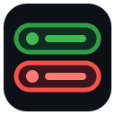

<div align="center">



# GitHub Public/Private Colors

**Repérez d'un coup d'œil vos dépôts publics et privés sur GitHub.**


</div>

---

## ✨ Fonctionnalités

- 🟢 Les labels **Public** passent en **vert**
- 🔴 Les labels **Private** passent en **rouge**
- 🎨 S'adapte à **tous les thèmes GitHub** (clair, sombre, dark dimmed, high contrast, daltonien, synchronisé avec le système), car l'extension reprend les variables CSS de GitHub
- 🌍 Reconnaît l'interface **en anglais et en français** (`Public` / `Publique`, `Private` / `Privé`…)
- ⚡ Fonctionne avec la **navigation dynamique** de GitHub (Turbo / React) : les nouveaux labels sont colorés dès qu'ils apparaissent
- 🔒 **Aucune permission demandée**, aucune donnée collectée : le script s'exécute seulement sur `github.com`

## 📍 Où les couleurs s'appliquent

| Page                                               | Élément coloré                                |
| -------------------------------------------------- | --------------------------------------------- |
| Liste des dépôts d'un profil ou d'une organisation | Label à côté du nom de chaque dépôt           |
| Page d'un dépôt                                    | Label de visibilité à côté du titre           |
| Recherche, épingles, tableau de bord               | Tous les labels `Public` / `Private` affichés |

## 📦 Installation

L'extension n'est pas publiée sur le Chrome Web Store. Pour l'installer à la main :

1. Clonez ou téléchargez ce dépôt :
    ```bash
    git clone https://github.com/Auguste-gmb/Github-visibility-colors.git
    ```
2. Ouvrez `chrome://extensions` (ou `edge://extensions`)
3. Activez le **Mode développeur** en haut à droite
4. Cliquez sur **Charger l'extension non empaquetée**
5. Sélectionnez le dossier du dépôt

C'est prêt : ouvrez GitHub et les labels sont colorés.

## 🗂️ Structure du projet

```
.
├── manifest.json   # Déclaration de l'extension (Manifest V3)
├── content.js      # Repère les labels et ajoute les classes de couleur
├── style.css       # Couleurs, basées sur les variables CSS de GitHub
├── icon.svg        # Logo source
└── icons/
    ├── icon16.png
    ├── icon48.png
    └── icon128.png
```

## ⚙️ Fonctionnement

1. `content.js` cherche les labels de visibilité avec plusieurs sélecteurs, pour couvrir l'ancien et le nouveau rendu de GitHub :
    - `span.Label`
    - `[data-component="Label"]`
    - `[data-testid="repo-visibility-label"]`
2. Il lit le premier mot du label et ajoute la classe `gh-vis-public` ou `gh-vis-private`.
3. Un `MutationObserver` surveille la page et relance la coloration, au plus une fois par frame, quand GitHub charge du contenu ou réécrit les classes.
4. `style.css` applique les couleurs `success` / `danger` du thème GitHub actif, avec des couleurs de secours si une variable manque.

## 🛠️ Personnalisation

- **Ajouter une langue** : complétez `PUBLIC_WORDS` et `PRIVATE_WORDS` dans `content.js`.
- **Changer les couleurs** : modifiez les règles `.gh-vis-public` et `.gh-vis-private` dans `style.css`.
- **Modifier le logo** : éditez `icon.svg`, puis régénérez les PNG, par exemple :
    ```bash
    for s in 16 48 128; do rsvg-convert -w $s -h $s icon.svg -o icons/icon$s.png; done
    ```

## 🤝 Contribuer

Si GitHub change son interface et qu'un label n'est plus coloré, ouvrez une issue avec une capture d'écran et l'URL de la page, ou proposez directement une pull request.

## 📄 Licence

Distribuée sous licence MIT. Voir le fichier [LICENSE](LICENSE).
